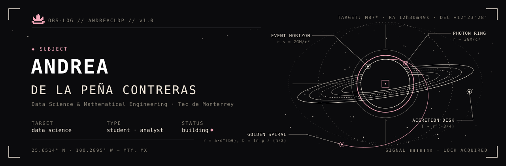

<!-- ═══════════════════════════════════════════════════════════════
     OBS-LOG // andreacldp
     palette: #0B0B0D (void) · #F2E9DC (cream) · #8A8478 (dust) · #F4A7B9 (lotus)
     ═══════════════════════════════════════════════════════════════ -->

<picture>
  <source media="(prefers-color-scheme: dark)" srcset="./assets/banner-dark.svg">
  <source media="(prefers-color-scheme: light)" srcset="./assets/banner-light.svg">
  
</picture>

 

> *Data scientist in training. I like problems where the math is elegant and the data is messy —
> from sales tables to seismic images to the occasional galaxy.*

 

### `01` &nbsp;OBSERVATION LOG

| ID | OBJECT | OBSERVATION | STACK |
|:--|:--|:--|:-- |
| `OBJ-001` | **Seismic Fault Detection** | Deep learning model that automatically detects geological faults in seismic images. | `PyTorch` `Python` `NumPy` |
| `OBJ-002` | **SIMA Air Quality Analysis** | Analysis of PM2.5 and PM10 across Monterrey's air-quality monitoring stations. | `Python` `pandas` `R` |
| `OBJ-003` | **Portfolio Website** | Personal site built with React + Vite on top of a custom design system. | `React` `Vite` `JavaScript` |
<!-- NEW OBJECT — copy this row, remove the comment tags and fill it in:
| `OBJ-004` | **Project Name** | One or two lines on what it does and what you found. | `Tool` `Tool` | [→ repo]([LINK]) |
-->

 

### `02` &nbsp;INSTRUMENTS

`LANGUAGES & LIBRARIES` 

`ANALYTICS & TOOLING` 

`MODELS IN THE FIELD` 

 

### `03` &nbsp;TELEMETRY

<picture>
  <source media="(prefers-color-scheme: dark)" srcset="https://github-readme-stats.vercel.app/api?username=andreacldp&show_icons=true&custom_title=STATS&bg_color=0B0B0D&title_color=F4A7B9&text_color=F2E9DC&icon_color=F4A7B9&border_color=2A2A2E&border_radius=0&hide_rank=true">
  
</picture>
<picture>
  <source media="(prefers-color-scheme: dark)" srcset="https://github-readme-stats.vercel.app/api/top-langs/?username=andreacldp&layout=compact&custom_title=SPECTRUM&bg_color=0B0B0D&title_color=F4A7B9&text_color=F2E9DC&border_color=2A2A2E&border_radius=0">
  
</picture>

 

### `04` &nbsp;CHANNELS

 

<code>── END OF TRANSMISSION ──</code>

